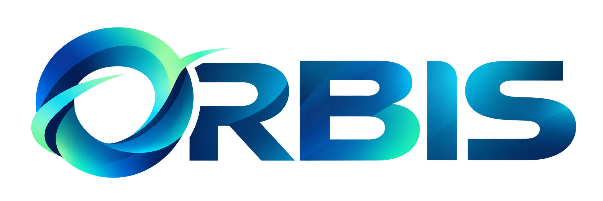
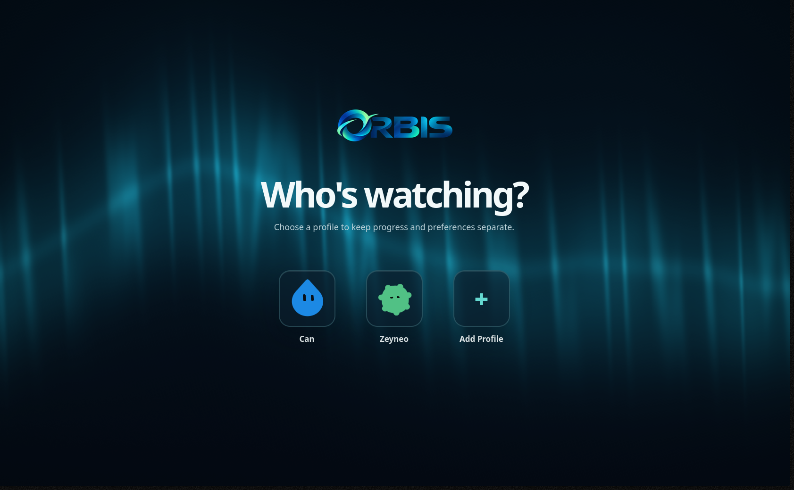
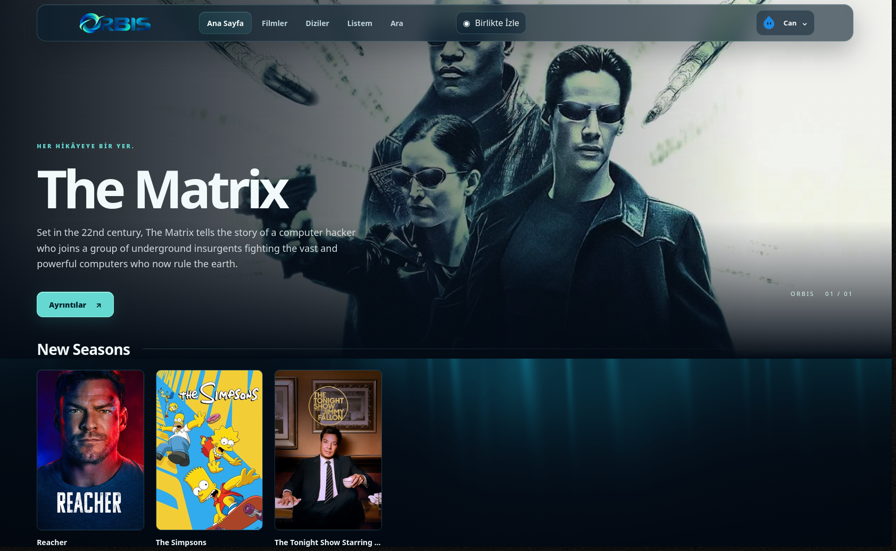
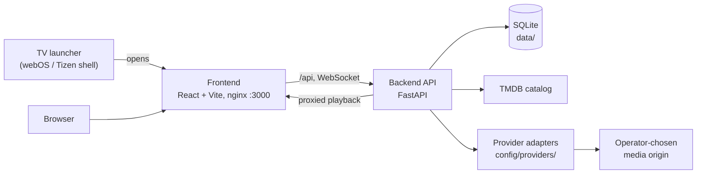

# Orbis

Orbis is a self-hosted, multi-profile media interface for a small household,
built with FastAPI, React and Docker and designed to run on a Raspberry Pi 5
(ARM64). Each profile keeps its own language, list, progress and watch history.

Playback comes from independently installed provider adapters on top of a
TMDB-based catalog with profile-specific discovery; Orbis itself ships no
general streaming provider (see [Providers](#providers)).

## Screenshots

<table>
  <tr>
    <td width="50%"></td>
    <td width="50%"></td>
  </tr>
  <tr>
    <td align="center">Profile picker</td>
    <td align="center">Home</td>
  </tr>
</table>

## What V1 includes

- English and Turkish profiles, onboarding, localized catalog/search, My List,
  Continue Watching and personalized Home/Movies/Series shelves.
- Movie and episode playback with automatic Provider → Source selection and
  fallback. Viewers control Quality, Audio and Subtitles; playback retains
  per-profile resume and adaptive delivery.
- Global Watch Together rooms with six-digit join codes. Participants browse
  independently until someone starts content; each resolves their own media
  source while the room synchronizes play, pause and timeline.
- Owner-only Admin for provider management, settings, diagnostics and sessions.
- Optional LG webOS and Samsung Tizen fullscreen launchers for Developer Mode
  sideloading. They open the same web frontend; they are not Store apps.

Orbis **does not include a general third-party streaming-site provider**.
The shipped reference adapter is a disabled synthetic authoring example. Install
and configure a provider you trust for playable media. Provider availability and
media rights are the operator's responsibility.

## Install

1. Install Docker Engine with the Compose plugin on an ARM64 or x86-64 host.
2. Clone this repository, then copy `.env.example` to `.env`.
3. Set `TMDB_API_KEY` in `.env` to your own TMDB API key. Do not commit it.
4. Run `docker compose up -d --build` from the repository root.
5. Open `http://<your-server>:3000`, choose the installation language, create
   the first profile and set its owner/Admin password. Later profiles are viewers.

The backend applies Alembic migrations before startup. SQLite lives under
`data/`; private provider code and settings live under `config/providers/`.
These directories and `.env` must be backed up and must remain private. The
frontend proxies `/api` to the backend; the standard public template publishes
only frontend port 3000. Put the service behind a trusted private network or
your own reviewed HTTPS ingress. Tailscale is an option, not a requirement.

An existing installation may retain older container names, database paths and
private Compose overrides; changing those names is not required for a GitHub
repository rename. See [operations and backup](docs/v1-operations.md).

## TV launchers

Build the shared Tizen WGT and stage the LG app with `python3 tv/build.py`;
build the LG IPK with `sh tv/build-webos.sh` (Docker and LG's CLI are used).
The artifacts are `tv/dist/orbis-tizen-1.0.0.wgt` and
`tv/dist/orbis-webos-1.0.0.ipk`. Neither package embeds a server address or
personal TV credentials. See the [webOS guide](docs/tv/webos.md) and
[Tizen guide](docs/tv/tizen.md) for sideloading, first-launch configuration,
and LG Developer Mode renewal. **Physical TV validation is pending.**

## Providers

Providers are trusted Python modules implementing the
[provider contract](docs/provider-authoring.md). A local module is installed and
versioned through Admin in `/config/providers/<provider-id>/`; source, settings
and secrets stay outside the repository. The guide walks through the neutral
reference provider, fixture service, validation, activation, rollback and
deletion. The factory reference is disabled by default.

## Architecture

The TV launchers only store a server address and open the same web frontend.
The frontend talks to the backend through `/api`; the backend owns profiles,
progress, rooms and the SQLite database, resolves playback through installed
provider adapters, and proxies media so source URLs and headers stay
server-side.

The frontend is React, TypeScript and Vite. FastAPI, SQLAlchemy, Alembic and
SQLite power the backend. TMDB supplies canonical movie/series identity and
localized metadata; SQLite FTS supports local search. Shaka Player is loaded
only on playback routes. See the [V1 API index](docs/backend-v1.md) and
[Watch Together contract](docs/watch-together.md).

For frontend development, run `npm ci` and `npm run build` in `app/frontend/`.
Backend dependencies are pinned in `app/backend/requirements.txt`; set a local
`DATABASE_URL` and run `alembic upgrade head` from `app/backend/`.

## Testing

No test needs a live third-party media provider; provider tests use the
synthetic fixtures in `app/backend/tests/provider_fixtures/`.

Automated in [CI](.github/workflows/ci.yml) on every push and pull request:

- Backend: `python -m pytest tests` in `app/backend/` (API, migrations,
  playback, providers, recommendations, Watch Together).
- Frontend: `npm run build` (TypeScript + Vite) and the Node unit tests
  `tests/audio-match.mjs` and `tests/profile-polish.mjs` in `app/frontend/`.
- TV shell: `node --test tv/tests/*.test.cjs`.

Manual: the Playwright browser smokes in `app/frontend/tests/` and
`app/backend/tests/manual/` require an explicitly isolated fixture
environment, and the [release acceptance](docs/release-acceptance.md) journeys
and physical TV sideloading are run by hand before a release.

## V1 boundaries

Watch Together rooms are ephemeral, in-process and require one backend worker;
a backend restart ends rooms. Disconnected participants have a 60-second
reconnect grace period; rooms are not stored across restarts. There is no chat, voice, offline download,
parental control or DRM-heavy commercial playback guarantee.

## Security model

Orbis targets a trusted household server on a private network. Only the owner
profile has an Admin password; viewer profiles are not separate authentication
accounts. Provider Python runs as trusted owner code, not inside a security
sandbox. See [SECURITY.md](SECURITY.md) before exposing Admin or the provider
editor outside a private network, and for reporting vulnerabilities.

## License and credits

TMDB and optional IMDb data have their own usage and attribution requirements;
see [data and attribution](docs/data-attribution.md). Orbis is licensed under
[AGPL-3.0-only](LICENSE). Organizations requiring terms incompatible with
AGPL-3.0 may contact the copyright holder about separate commercial licensing.

Contribution guidance is in [CONTRIBUTING.md](CONTRIBUTING.md). Direct
dependency and bundled-asset credits are in
[third-party notices](THIRD_PARTY_NOTICES.md). The approved TMDB mark and
required notice appear in the in-app profile Credits/data-sources section.
